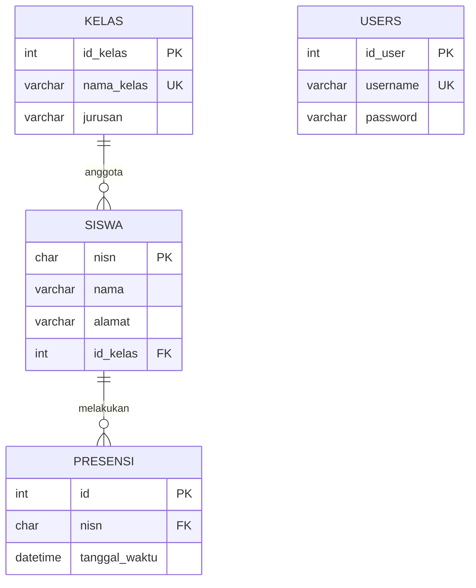

# Aplikasi Presensi Siswa

Aplikasi web presensi siswa untuk SMK TI Airlangga Samarinda. Administrator dapat mengelola kelas dan siswa, mencatat simulasi tap kartu RFID menggunakan NISN, lalu melihat dan memfilter rekap kehadiran.

Proyek ini dibuat dengan PHP native tanpa framework, PDO, pemrograman berorientasi objek (OOP), dan MariaDB. Siswa yang tidak melakukan tap tidak memiliki catatan presensi pada hari tersebut.

## Fitur

- Login dan logout administrator dengan session.
- Kelola kelas: tambah, lihat, ubah, dan hapus. Nama kelas harus unik; kelas yang masih memiliki siswa tidak dapat dihapus.
- Kelola siswa: tambah, lihat, ubah, dan hapus; validasi NISN 10 digit yang unik; pencarian berdasarkan nama atau NISN.
- Simulasi tap kartu dengan NISN. Waktu presensi dicatat otomatis oleh database; NISN yang tidak terdaftar ditolak.
- Rekap presensi harian dengan filter tanggal dan kelas, pencarian nama/NISN, serta penghapusan log.
- Dashboard ringkas untuk jumlah siswa, kelas, kehadiran, dan rekap per kelas.
- Antarmuka responsif untuk layar kecil.

## Teknologi dan persyaratan

- PHP 8.0 atau lebih baru dengan ekstensi PDO MySQL (`pdo_mysql`).
- MariaDB atau MySQL.
- Web server lokal, misalnya Apache melalui XAMPP.

## Instalasi lokal

1. Salin atau clone folder proyek ke direktori web server, misalnya `htdocs/presensi` pada XAMPP.
2. Jalankan Apache dan MariaDB.
3. Buat database dan tabel dengan mengimpor `schema.sql`. Contoh melalui terminal:

   ```bash
   mysql -u root -p < schema.sql
   ```

   Jika akun root lokal tidak memakai password, hilangkan `-p`.
4. Periksa pengaturan koneksi di `classes/Database.php`. Nilai awalnya adalah host `localhost`, database `presensi_siswa`, pengguna `root`, dan password kosong.
5. Dari direktori proyek, jalankan seeder satu kali:

   ```bash
   php seed.php
   ```

   Seeder membuat data kelas contoh dan akun administrator. Kelas contoh yang dimasukkan adalah X PPLG 1, X PPLG 2, XI PPLG 1, XII PPLG 1, dan X TJKT 1.
6. Buka `http://localhost/presensi/` (sesuaikan `presensi` dengan nama folder proyek Anda).

## Akun demo

Seeder menyediakan akun berikut:

| Username | Password |
| --- | --- |
| `admin` | `admin123` |

Ganti kredensial demo sebelum aplikasi digunakan di lingkungan publik.

## Struktur database

`schema.sql` membuat database `presensi_siswa` dan empat tabel:

| Tabel | Kegunaan | Kolom utama |
| --- | --- | --- |
| `kelas` | Data kelas | `id_kelas` (PK), `nama_kelas` (unik), `jurusan` |
| `siswa` | Data siswa | `nisn` (PK, CHAR(10)), `nama`, `alamat`, `id_kelas` (FK) |
| `presensi` | Catatan setiap tap | `id` (PK), `nisn` (FK), `tanggal_waktu` (default `CURRENT_TIMESTAMP`) |
| `users` | Akun administrator | `id_user` (PK), `username` (unik), `password` (hash) |

Relasi inti: satu kelas memiliki banyak siswa; satu siswa dapat memiliki banyak catatan presensi. Tabel `users` berdiri sendiri untuk keperluan login.



## Pengujian

Repository menyertakan bukti tangkapan layar pada folder `assets/`. Cocokkan hasil akhir pengujian dengan lingkungan yang digunakan saat demo.

| No. | Skenario | Hasil yang diharapkan | Bukti |
| --- | --- | --- | --- |
| 1 | Login dengan password salah | Login ditolak dengan pesan umum kesalahan. | [Tangkapan layar](assets/uji_1.png) |
| 2 | Membuka halaman terlindungi tanpa login | Pengguna diarahkan ke halaman login. | [Tangkapan layar](assets/uji_2.png) |
| 3 | Menambahkan siswa dengan NISN 9 digit | Validasi gagal dan pesan kesalahan ditampilkan. | [Tangkapan layar](assets/uji_3.png) |
| 4 | Menambahkan NISN yang sudah terdaftar | Data ditolak dengan pesan bahwa NISN sudah terdaftar. | [Tangkapan layar](assets/uji_4.png) |
| 5 | Tap menggunakan NISN yang tidak terdaftar | Tap ditolak dengan pesan yang jelas. | [Tangkapan layar](assets/uji_5.png) |
| 6 | Tap menggunakan NISN valid | Presensi masuk ke rekap dan waktu tercatat otomatis. | [Tangkapan layar](assets/uji_6.png) |
| 7 | Menghapus kelas yang masih memiliki siswa | Penghapusan ditolak dengan pesan yang mudah dipahami. | [Tangkapan layar](assets/uji_7.png) |
| 8 | Mencari siswa dengan sebagian nama | Daftar menampilkan siswa yang sesuai pencarian. | [Tangkapan layar](assets/uji_8.png) |

## Berkas penting

```text
assets/             Stylesheet dan bukti tangkapan layar pengujian
classes/            Database, BaseModel, dan model Kelas, Siswa, Presensi, User
includes/           Inisialisasi aplikasi dan komponen layout
schema.sql          DDL database dan tabel
seed.php            Seeder kelas contoh dan akun administrator
login.php           Halaman login
kelas.php           Daftar dan pengelolaan kelas
siswa.php           Daftar, pencarian, dan pengelolaan siswa
tap.php             Simulasi tap kartu
rekap.php           Rekap, filter, pencarian, dan penghapusan log
dashboard.php       Ringkasan data presensi
```
